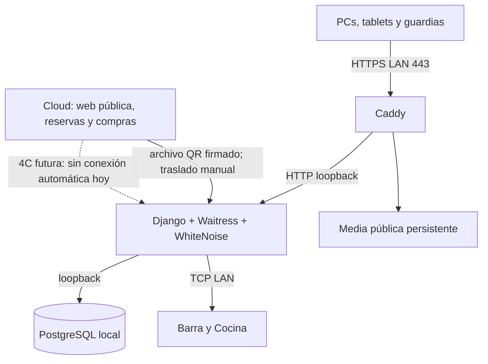

# BIG PARTY Local Node · Fase 4B

Un nodo PostgreSQL/Django dentro del establecimiento mantiene la operación interna cuando no hay Internet. PCs, tablets y guardias comparten **una única base local** a través de HTTPS LAN. Cada dispositivo necesita la LAN; esta fase no ofrece funcionamiento aislado en cada tablet.



## Perfiles y límites

`DEPLOYMENT_MODE` acepta `development`, `cloud` o `local_node`; no se deduce de `DEBUG`. Desarrollo usa `config.settings.dev`; cloud conserva `config.settings.prod`; el nodo usa `config.settings.local_node` con `DEBUG=False`. Seleccionar siempre ambos valores coherentemente. `.env.local-node` se carga mediante `BIGPARTY_ENV_FILE`; variables ya presentes en el proceso tienen precedencia. El lanzador Windows fija el perfil local y no evalúa el archivo como código.

En el nodo funcionan `/operacion/`, `/caja/`, `/gerencia/`, `/acceso/`, `/impresoras/` y `/admin/`. `/`, `/eventos/`, `/reservas/`, `/entrada/`, `/dev/`, sitemap y robots responden 404 controlado sin redirigir a Internet. Esto incluye POST de nuevas compras, reservas y comprobantes. La administración muestra únicamente datos que realmente existen en esa base. No se copian automáticamente catálogo, usuarios, reservas ni eventos del cloud.

Pedidos, subcuentas, modificadores, inventario, comandas, efectivo, registro manual de tarjeta, handoffs, retiros y cierres reutilizan los servicios existentes. Transferencia y depósito quedan PENDING hasta una verificación autorizada: nunca se consulta un banco ni se confirman automáticamente. La conectividad de la terminal bancaria es independiente del nodo.

## Identidad y estado

`LocalNodeIdentity` tiene una única fila (PK 1 y restricción PostgreSQL), UUID aleatorio, nombre y fecha. `init_local_node` y `prepare_local_node` son idempotentes. Reiniciar, actualizar código o restaurar una copia íntegra de la base conserva el UUID. No clonar una base para operar simultáneamente dos nodos con la misma identidad.

`/gerencia/configuracion/nodo-local/` exige sesión Gerencia y `core.view_configuration`; muestra UUID abreviado, base, impresoras, versiones y snapshots. `APP_VERSION`/`APP_COMMIT` se inyectan durante instalación, sin ejecutar Git en solicitudes. `/healthz/` indica proceso vivo; `/readyz/` comprueba PostgreSQL. No contactan impresoras ni cloud; una impresora apagada no derriba readiness.

`check_local_node` diagnostica sin cambios, con código 1 ante requisitos faltantes; impresoras sin dirección y ausencia de snapshots son avisos visibles. No verifica físicamente que una impresora esté encendida. `prepare_local_node` crea únicamente defaults existentes e identidad; no crea superusuarios, migra ni borra datos.

## Snapshot QR manual

El exportador reutiliza `build_event_access_snapshot(event)` de 3C: `schema_version=1`, ID de evento, nombre, estado y tickets con `token_hash`, `status`, `ticket_type`. Se conservan `version` y `checksum` SHA-256 del contenido canónico existente. Se agregan `source` y `signature` al transporte; HMAC-SHA256 firma **todos** los campos salvo `signature`, incluida la fecha y fuente. JSON canónico: claves ordenadas, separadores compactos y UTF-8 sin escapar Unicode. No contiene comprador, teléfono, monto, portal token ni QR en claro.

`ACCESS_SNAPSHOT_SIGNING_KEY` aleatoria (mínimo 32 bytes) y `ACCESS_SNAPSHOT_SOURCE` deben coincidir en origen y nodo. HMAC autentica, no cifra; quien posee la clave también puede firmar. Proteger el archivo y ambos entornos. Los snapshots antiguos sin firma no se aceptan: volver a exportarlos con el comando de 4B. Identificador de evento local: fuente + ID estable en la base fuente; mantener esa fuente única al restaurar/migrar cloud. `version` es hash de contenido, no contador; `generated_at` firmado establece orden. Relojes del origen deben ser correctos; se toleran 5 minutos de adelanto.

```text
# En la base fuente (development/cloud)
python manage.py export_event_access_snapshot <ID-o-slug-evento> <archivo-nuevo.json>
# Tras copiar manualmente el archivo al nodo
python manage.py import_event_access_snapshot <archivo.json>
```

El exportador no sobrescribe archivos. El importador limita el tamaño a 20 MiB, valida campos, versión, firma, checksum, digests únicos, estados, fuente y fecha; todo se aplica en una transacción. Importar idéntico contenido es idempotente. Versiones anteriores o distintas con igual fecha se rechazan. El archivo representa el conjunto completo: tickets omitidos se cancelan.

Merge conservador: `CANCELLED` prevalece; una cancelación permanece cancelada aunque un archivo posterior diga VALID. `USED` local o de origen permanece USED; el `used_at` local nunca se borra. Solo un scan exitoso local crea ese timestamp, por lo que el contador «usadas localmente» no inventa usos del cloud. Un evento cancelado revoca todas sus entradas. No hay mecanismo de reabrir entradas canceladas en 4B.

En local, `/acceso/` calcula SHA-256 del QR y consulta exclusivamente `LocalAccessTicket`. El QR puede ser token o URL de entrada del `PUBLIC_BASE_URL` fuente (solo se analiza el texto, nunca se visita). Sin snapshot: no disponible localmente. Fila bloqueada mediante `SELECT FOR UPDATE`: entre dos guardias uno recibe VÁLIDA y otro YA UTILIZADA. `LocalAccessScan` conserva nodo, evento, versión, digest, resultado, guardia y fecha; modelo y trigger PostgreSQL impiden UPDATE/DELETE. Un administrador de base sigue siendo una autoridad privilegiada. No se envían scans a ninguna parte.

## Runtime, datos y seguridad

Waitress escucha solo loopback; Caddy publica HTTPS LAN y fija el esquema confiable. Django no confía directamente en encabezados arbitrarios del cliente. Cookies host-only, HttpOnly para sesiones y SameSite Lax; Secure en HTTPS. Hosts y orígenes CSRF son explícitos, sin comodines. Los vínculos de dispositivos/cajas y sesiones PIN conservan su alcance por ruta y no dependen de localhost.

WhiteNoise entrega `collectstatic` con manifiesto, compresión y assets locales. QR Scanner 1.4.2, worker y licencia MIT permanecen en `static/vendor/qr-scanner/`. Las interfaces internas no requieren fuentes, JS, CSS ni APIs de Internet. Caddy sirve solo `LOCAL_MEDIA_ROOT`; comprobantes privados permanecen fuera, accesibles únicamente a través de las vistas autorizadas existentes.

Logs `application.log` y `printing.log`: máximo 5 MiB por archivo y cinco copias por canal. Un filtro conserva códigos operativos seguros y descarta URLs, mensajes arbitrarios, argumentos y tracebacks; no registra PIN, claves o QR. La información detallada de trabajos sigue en el panel de impresión con permisos existentes. No habilitar access logs del proxy con URLs sensibles. Usar una sola instancia de aplicación por nodo.

## Validación y siguientes fases

Pruebas PostgreSQL cubren firma, corrupción, merge, concurrencia real de guardias, protección del registro, perfiles, límites públicos, cookies, diagnóstico y una jornada POS con red pública bloqueada. La simulación Mac utiliza otra base y Waitress; debug printing se permite únicamente con `LOCAL_NODE_ALLOW_DEBUG_PRINTER=True`. HTTP de simulación no acredita cámara móvil LAN.

Windows, impresoras físicas, DNS del router, CA en cada dispositivo y recuperación tras reinicio eléctrico requieren validación física posterior (4F). Ver [instalación Windows](../deployment/LOCAL-NODE-WINDOWS.md).

**No implementado:** 4C sincronización automática (sin API, polling, outbox/inbox ni resolución general de conflictos); 4D sistema de backups; replicación de media; failover o redundancia. DB/media son persistentes y deben protegerse, pero esta fase no programa copias. Un snapshot solo refleja el momento de exportación: entradas vendidas/canceladas después necesitan otra importación manual. Operar acceso de un evento en un único nodo; escaneos simultáneos independientes cloud/local pueden duplicar admisiones y requieren una política operativa hasta 4C.

### Resultado de validación de 4B en Mac

- Suite completa: 973 pruebas Django y 13 JavaScript aprobadas; `check`, `makemigrations --check` y revisión de diff sin errores.
- Perfil real `DEBUG=False`, PostgreSQL temporal separado, `migrate`, `collectstatic`, `prepare_local_node`, `check_local_node` y Waitress arrancados correctamente. La recolección incluye los dos source maps oficiales faltantes del QR Scanner; módulo/worker originales verificados contra el paquete 1.4.2.
- Solicitudes HTTP reales con cookies y CSRF: login técnico, asociación de tablet/caja, PIN, apertura de jornada, mesa, pedido, stock, impresión debug, efectivo/tarjeta, handoff, cierre de cuenta/caja/jornada y Gerencia.
- Exportación firmada desde el perfil fuente e importación en local; guardia autenticado, primer QR VALID y segundo USED. El ticket fuente permaneció VALID: el scanner operó su caché local.
- GET/POST públicos bloqueados, CSS/JS/worker servidos por WhiteNoise y conexiones públicas bloqueadas durante la simulación. Una prueba adicional transmite bytes ESC/POS a un receptor TCP loopback para comprobar el backend network.
- Proceso Waitress detenido y base, entorno, logs, media, impresión debug y static temporales eliminados al terminar. No se desplegó en el establecimiento. PowerShell, Caddy y certificados móviles no se ejecutaron/instalaron en Mac.
