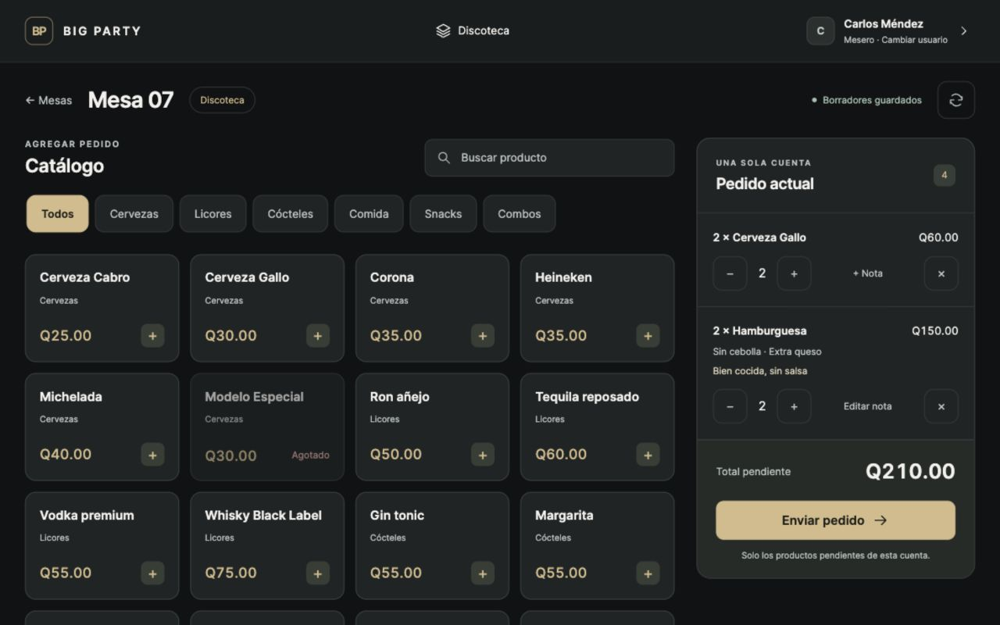
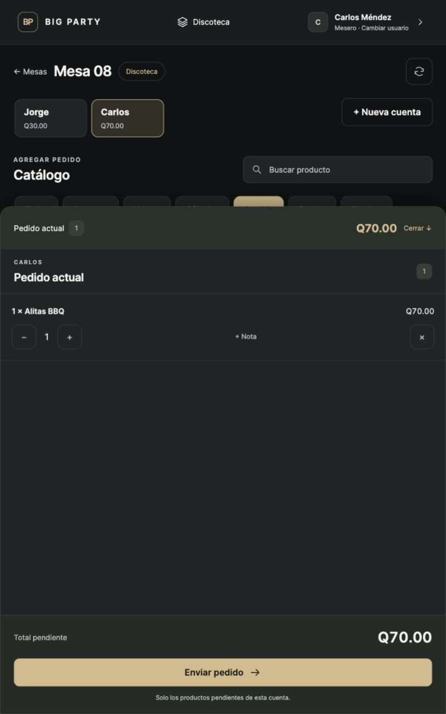

# Verificación Fase 2B — 28 de septiembre de 2026

La interfaz se probó en el navegador integrado, contra Django y PostgreSQL reales.
Se creó una base desechable independiente para la prueba manual; usuarios, PIN,
dispositivo, catálogo, existencias, jornada y órdenes eran exclusivamente temporales.
No se añadieron cuentas de demostración a la base del proyecto.

## Comprobación automática

- `python manage.py test --noinput`: **431 pruebas aprobadas**, incluidas 49 nuevas.
- `node --test apps/operations/tests/catalog-filter.test.mjs`: **2 pruebas aprobadas**.
- `python manage.py check`: sin incidencias.
- `python manage.py makemigrations --check --dry-run`: sin cambios.
- Conservadas todas las pruebas anteriores de concurrencia, órdenes, pagos, caja y acceso.

## Recorrido SINGLE

1. Jornada abierta mediante el servicio backend existente; tablet asignada a Discoteca.
2. Ingreso como Carlos Méndez con PIN y apertura visual de Mesa 07 como SINGLE.
3. Panel de mesa ocupada → Agregar pedido → catálogo real de 20 productos y seis categorías.
4. Cervezas + búsqueda «Gallo»: únicamente el producto coincidente. Precio de área Q30
   frente a base Q25. Dos toques: una línea agrupada de dos unidades, Q60.
5. Comida: solo productos de esa categoría. Hamburguesa con Sin cebolla + Extra queso,
   nota «Bien cocida, sin salsa» y cantidad dos: cotización backend Q150.
6. Pedido actual: dos líneas, cuatro unidades, total Q210.
7. Enviar: aviso «Pedido enviado · Barra 2 · Cocina» y panel de pendientes vacío.
8. Agregar Cabro y enviar otra vez: «Pedido enviado · Adición · Barra 2».
9. Comprobación backend: Gallo ×2, Hamburguesa ×2 y Cabro ×1 en SENT;
   tickets NEW y ADDITION, sin reprocesar líneas del primer envío.

Modelo y su combo sin existencias permanecieron visibles, etiquetados Agotado y
deshabilitados. Las tarjetas funcionaron sin imágenes de producto.

## Recorrido SPLIT y persistencia

1. Apertura de Mesa 08 en SPLIT; catálogo bloqueado hasta elegir una cuenta.
2. Crear Jorge: selección automática; agregar Gallo Q30.
3. Crear Carlos: selección automática; agregar Alitas Q70.
4. Alternar entre ambos: borradores e importes independientes.
5. Enviar Jorge: su Gallo pasa a SENT; Alitas de Carlos permanece DRAFT.
6. Cambiar mesero a Ana López mediante PIN; volver a Mesa 08 y seleccionar Carlos:
   su borrador sigue guardado con el mismo importe.
7. El acceso volvió al selector tras la expiración de la sesión por inactividad.
   La persistencia ante sesión vencida y cambio de usuario también está cubierta
   por las pruebas automatizadas.

La comprobación final encontró tres tickets: NEW, ADDITION y NEW. Gallo pasó de
60 a 57 unidades por los tres productos enviados, sin descontar borradores.

## Revisión visual y límites

- Horizontal 1280×800: catálogo y panel aproximadamente 70/30, cabecera compacta,
  botones táctiles, total y envío visibles.
- Vertical 800×1280: catálogo completo con panel inferior plegable; sin desbordamiento
  horizontal (ancho del documento y viewport: 800 px).
- Panel del mapa con overlay del 15%, contraste mejorado y búsqueda visible.
- No se registraron errores ni advertencias en la consola del navegador durante el recorrido.
- Las capturas son imágenes del sitio en ejecución, sin montaje ni datos simulados en HTML.
- La base manual temporal se eliminó al terminar. Se conservan estas capturas como evidencia.
- Pendiente únicamente la revisión del usuario y validación en tablet Android física.
  Ver cuenta y pagos visuales no se implementaron.
