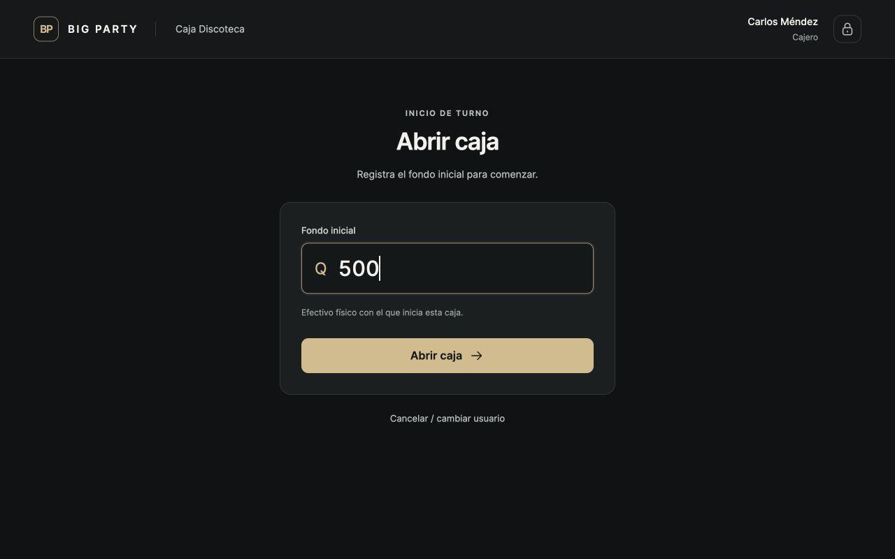
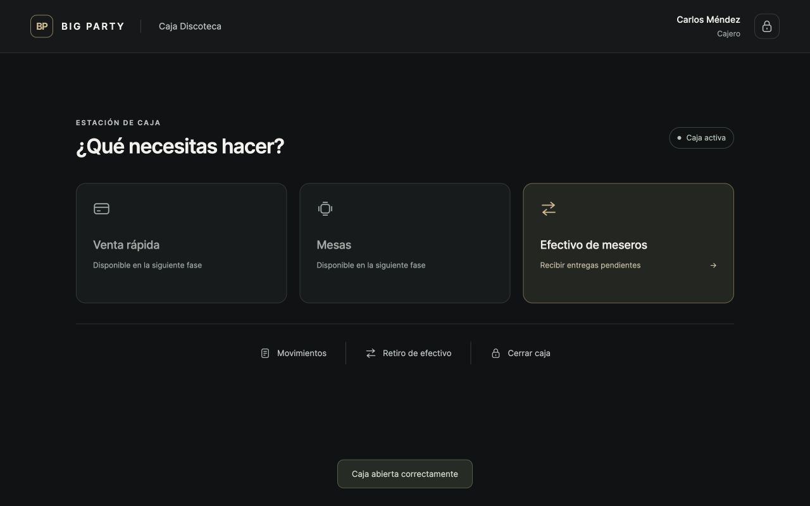
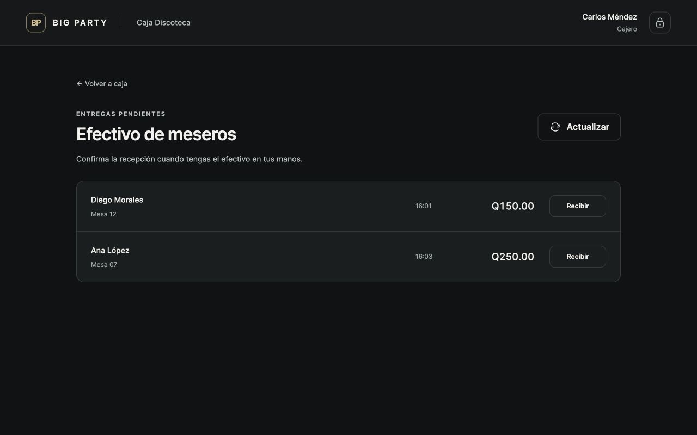
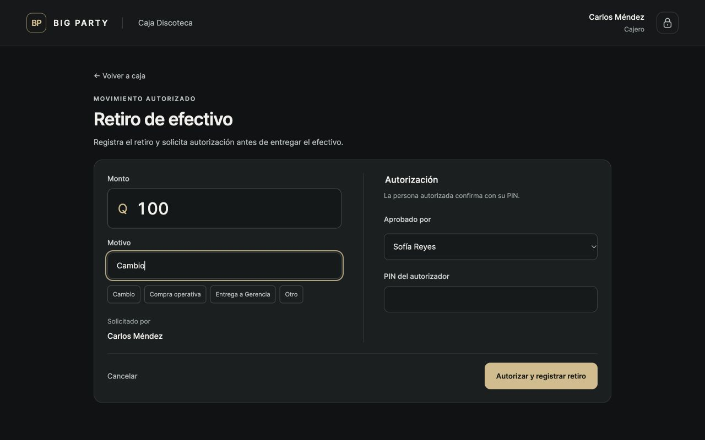
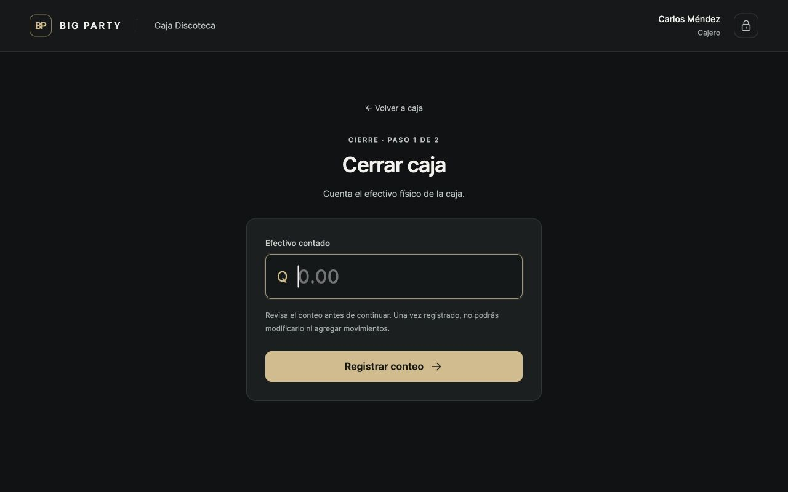
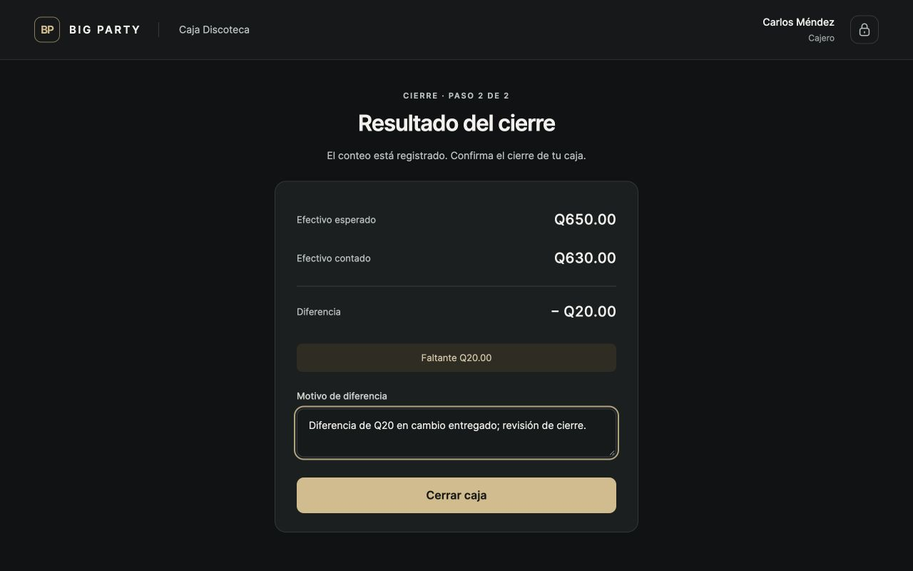
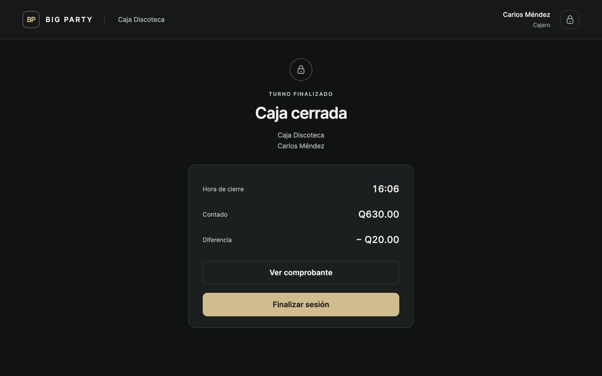
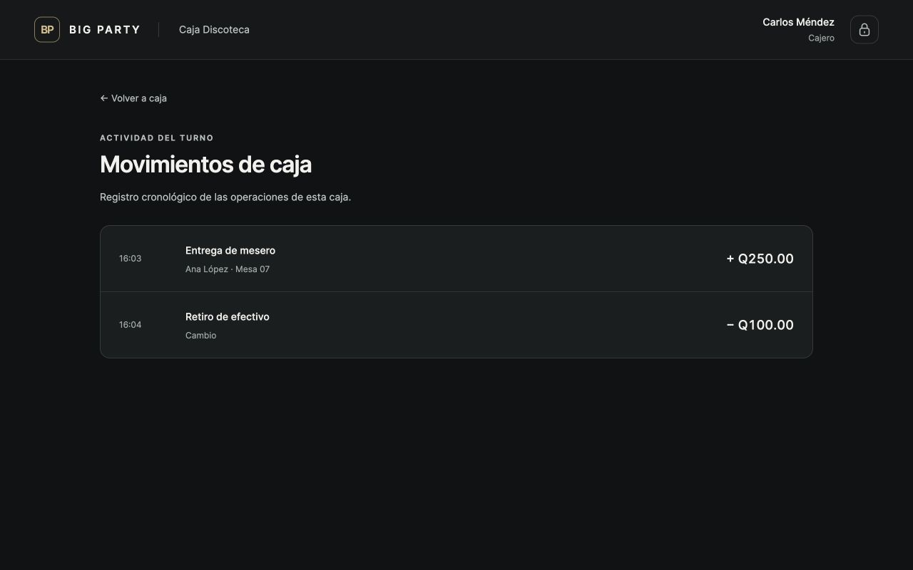

# Verificación de Fase 2D — Caja Windows

Fecha: 28 de septiembre de 2026. Interfaz real: `/caja/`.

## Resultado automatizado

- **545 pruebas Django aprobadas**, 61 nuevas para la estación de caja.
- **6 pruebas JavaScript aprobadas**; se conservan los módulos de pagos de 2C.
- `manage.py check`: sin problemas.
- `manage.py makemigrations --check --dry-run`: sin cambios pendientes.
- `git diff --check`: sin errores de espacios.

Las 57 pruebas funcionales nuevas cubren configuración firmada, permisos, cookies,
revocación, PIN, bloqueo, timeout, jornada, apertura, privacidad de HTML/JSON,
entregas, retiros con PIN y permiso real, movimientos, cierre ciego, diferencias,
inmutabilidad, aislamiento entre estaciones, formularios obsoletos, CSRF y POST.
Las cuatro pruebas de concurrencia usan conexiones PostgreSQL separadas:

1. Dos cajas reciben simultáneamente la misma entrega: una recepción y un error humano.
2. Cinco PIN incorrectos simultáneos conservan los cinco intentos y activan el bloqueo.
3. Dos confirmaciones simultáneas del mismo retiro producen un solo movimiento.
4. Dos aperturas simultáneas en una estación producen una sola CashSession.

## Recorrido manual real

Se utilizó el navegador de revisión y una base PostgreSQL desechable,
`bigparty_visual_2d_20260928`, con usuarios y operaciones ficticios. La base real no
recibió estos datos. Los nombres de las capturas pertenecen a ese escenario.

1. Se abrió una jornada mediante el servicio existente durante la preparación.
2. Se abrió `/caja/` sin configuración y se comprobó el mensaje de estación pendiente.
3. Se ingresó al acceso administrativo y se configuró **Caja Discoteca** en la UI.
4. Se seleccionó **Carlos Méndez**, se ingresó su PIN y se confirmó con Enter.
5. Se abrió caja con **Q500** usando Enter. Caja activa mostró acciones y confirmación,
   sin fondo inicial, esperado, diferencia ni totales financieros.
6. En otra pestaña se configuró una tablet ficticia y se accedió como **Ana López**.
7. Desde **Mapa de mesas → Mesa 07 → Ver cuenta → Cobrar → Efectivo**, se registró
   un pago de **Q250**. La orden y su consumo estaban preparados en la base desechable.
8. Caja mostró la entrega de Ana, Mesa 07, Q250, junto a una entrega previa de Diego,
   Mesa 12, Q150. No mostró un total de entregas.
9. Se abrió la confirmación, se probó Escape, se volvió a abrir y se recibió Q250.
   La entrega de Ana desapareció y se mostró **Efectivo recibido**.
10. Se solicitó un retiro de **Q100**, motivo **Cambio**, y se seleccionó a
    **Sofía Reyes**. Su PIN autorizó el retiro; Carlos siguió como titular y solicitante.
11. Movimientos mostró **+Q250 Ana López · Mesa 07** y **−Q100 Cambio**, en orden,
    sin acumulado, fondo inicial ni esperado.
12. Cierre paso 1 mostró el campo vacío. Se inspeccionó el HTML del documento:
    no contenía `expected_cash`, `efectivo esperado` ni `650.00`.
13. Se registró **Q630**. Solo entonces apareció **esperado Q650**, **contado Q630**,
    **faltante Q20**. Se intentó cerrar sin motivo y el formulario lo impidió.
14. Se escribió el motivo y se cerró. La pantalla final mostró hora, Q630 y −Q20.
15. **Ver comprobante** abrió el registro HTML con motivo y valores congelados.
16. **Finalizar sesión** volvió al selector. Carlos ingresó nuevamente y abrió
    una CashSession distinta con fondo **Q0**.
17. La segunda sesión registró conteo Q0, mostró **Caja cuadrada** y cerró sin motivo.
18. La entrega de Diego permaneció pendiente y no bloqueó ninguno de estos cierres.

Se comprobó en PostgreSQL que existen dos sesiones cerradas, un único movimiento de
recepción de Q250, un único retiro de Q100 con solicitante y autorizador correctos,
y una entrega de Q150 sin asignar. No hubo errores ni advertencias de consola en caja.
Al terminar se eliminaron la base desechable y sus scripts, y se detuvo el servidor de revisión.

## Tamaños y teclado

Se probaron las ocho pantallas de apertura, activa, entregas, retiro, movimientos,
conteo, resultado y cerrada en **1366×768** y **1920×1080**. Ninguna tuvo desbordamiento
horizontal. En 1366×768, resultado con motivo ocupa 778 px de documento: el botón
queda visible y solo hay 10 px adicionales de margen inferior desplazable.
Las capturas A–G son **1280×800**. Retiro se compactó para mantener formulario y
acción completos en 1366×768. Enter confirmó PIN y apertura; Escape cerró el diálogo
sin recibir efectivo. Se usan inputs nativos, orden de tabulación del documento y
focus visible. No hay teclado numérico táctil en caja.

La validación se realizó en el navegador de escritorio de macOS con estas resoluciones.
La prueba física en las tres computadoras Windows del local queda para la revisión operativa.

## Ajustes de 2C

Solo estilos: Volver a cuenta más secundario, focus champagne más suave, columna de
resumen resistente a cambios de contenido. Se midió **356.40625 px de ancho** y
**891.59375 px de posición horizontal** para Resumen de cuenta en efectivo, tarjeta,
transferencia, depósito y mixto a 1280 px. Se conserva el historial compacto y toda
la lógica de pagos previa.

## Capturas

Las imágenes son capturas del navegador, no maquetas. A y B se actualizaron durante
la prueba de reapertura para reflejar el último ajuste de espaciado; C–G documentan
la primera sesión y su cierre con faltante.

### A. Abrir caja

### B. Caja activa

### C. Efectivo de meseros

### D. Retiro de efectivo

### E. Cierre antes del conteo

### F. Resultado del cierre

### G. Caja cerrada

### Adicional: movimientos

