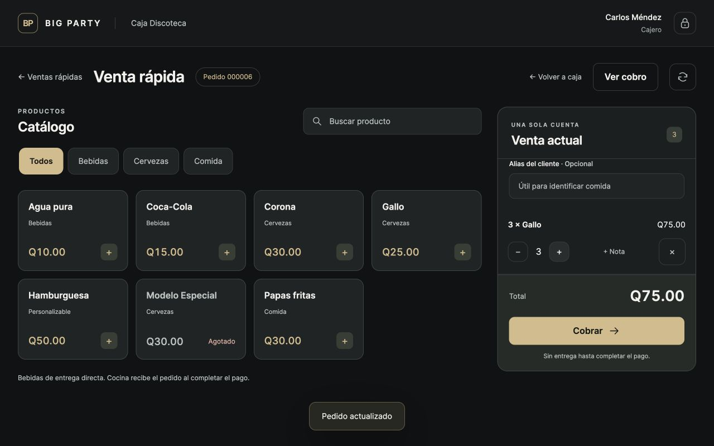
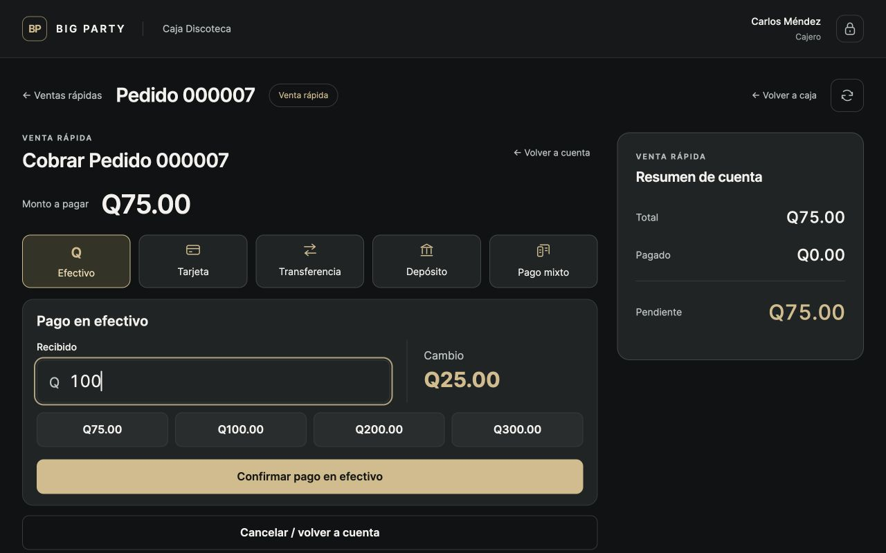
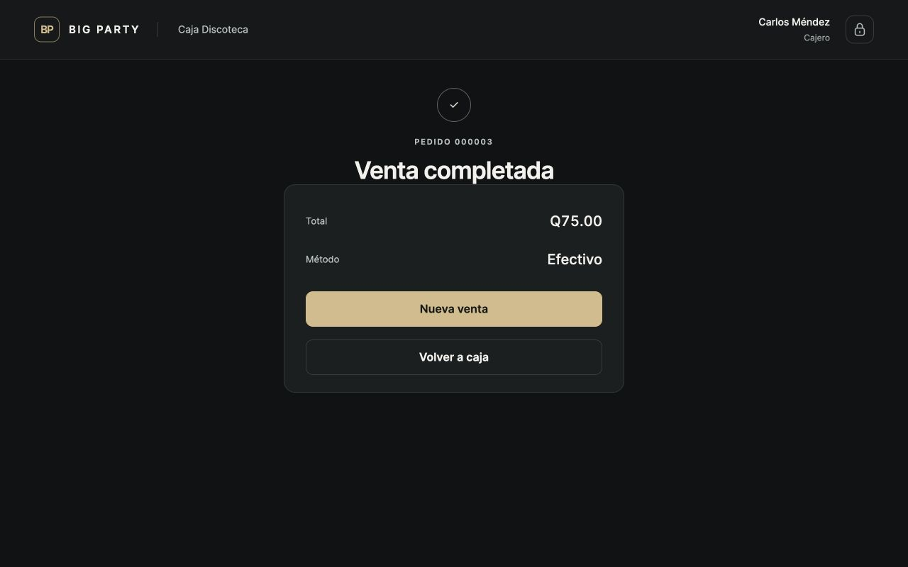
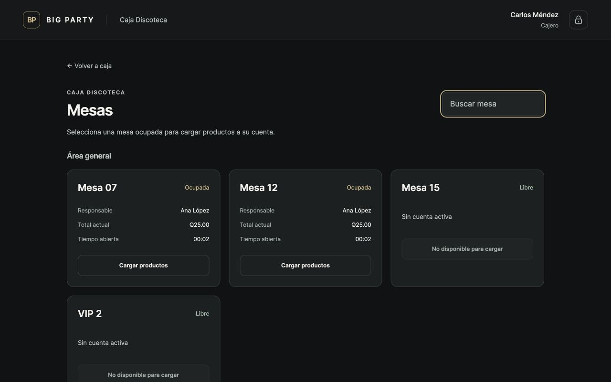
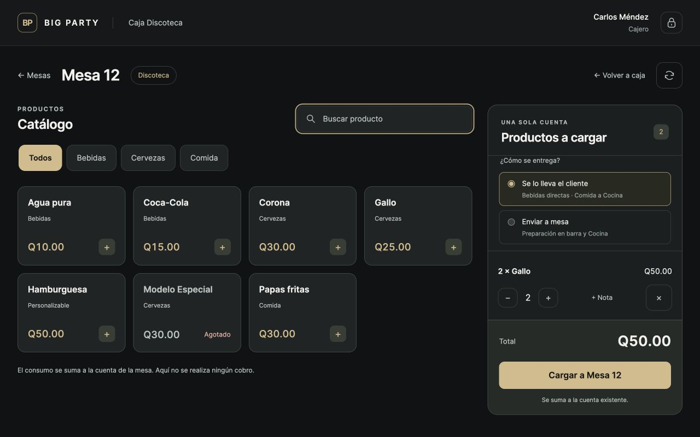
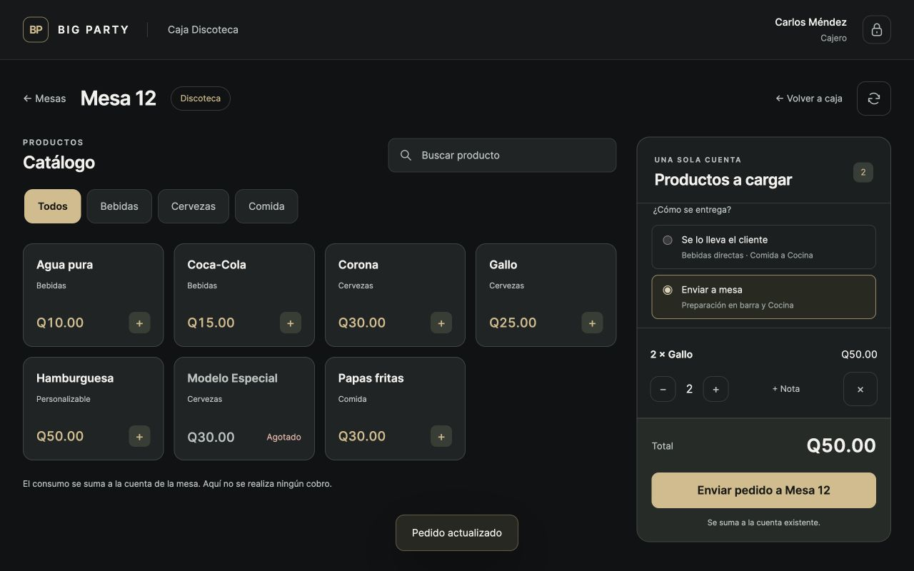

# Fase 2E — Verificación

Revisión realizada el 28 de septiembre de 2026. Venta rápida y carga a mesas terminadas;
impresoras y Gerencia final permanecen fuera de esta entrega.

## Validación automática

- `python manage.py check`: sin incidencias.
- `python manage.py makemigrations --check --dry-run`: sin cambios pendientes.
- `python manage.py test --noinput`: **611 pruebas aprobadas**, 66 nuevas sobre las 545 de 2D.
- `node --test apps/operations/tests/*.test.mjs`: **6 aprobadas**.
- `git diff --check`: correcto.
- Nueva migración `orders.0005_alter_tableorder_options_orderline_draft_origin_and_more`
  aplicada tanto a la base temporal como a la base local existente, sin reiniciar datos.

Las pruebas nuevas están en `apps/operations/tests/test_cash_sales.py`. Cubren creación
sin mesa y restricciones de tipo, precios por área, modificadores/notas, alias, stock,
combos, rutas, reversión ante errores, todos los métodos de pago, cierre, aislamiento de
sesiones/áreas, permisos, CSRF, repetición, subcuentas y separación de borradores.
Cuatro pruebas usan conexiones PostgreSQL simultáneas para competir por el último
producto, repetir un cobro, agregar caja+mesero y cerrar una mesa mientras caja agrega.

## Recorrido manual real

Se ejecutó en navegador a **1280 × 800** contra Django y PostgreSQL reales. Se creó una
base aislada `bigparty_visual_2e_20260928`, con nombres ficticios y fondo de Q500, sin
usar ventas reales. La base fue eliminada y se comprobó su ausencia; también se detuvo
el servidor temporal. Las imágenes son capturas del navegador, sin recrear la interfaz.

Preparación: jornada abierta, Caja Discoteca configurada, ingreso de Carlos Méndez por
PIN y apertura del turno desde la UI. Gallo inició con 100 unidades, Hamburguesa con 20.
Las mesas 07 y 12 tenían una Gallo enviada cada una; Mesa 07 era SPLIT. Los datos de
catálogo y mesas se prepararon como fixtures; las ventas y adiciones siguientes se
realizaron con controles reales de la aplicación.

| Escenario | Operación en pantalla | Resultado comprobado en base de datos |
| --- | --- | --- |
| 1: bebidas | Pedido 000003, 3 Gallo, Q75 en efectivo, recibido Q100 | Cerrada; cambio Q25; stock −3; `DIRECT_CASH_PAYMENT` Q75 en sesión actual; `NOT_REQUIRED`; sin handoff ni ticket de barra. |
| 2: comida | Pedido 000004, Hamburguesa con queso extra y nota «Sin cebolla», alias «Juan camisa azul», tarjeta Q55 | Cerrada; stock −1; ticket Cocina con número, Caja Discoteca, alias, modificador y nota. |
| 3: mixto | Pedido 000005, Gallo Q25; efectivo Q10 y tarjeta Q15 | Abierta después del abono, cerrada después de tarjeta; dos pagos, stock descontado una sola vez, movimiento directo Q10. |
| 4a: llevar | Mesa 12, 2 Gallo, Se lo lleva el cliente | Total Q25 → Q75; stock −2; sin ticket nuevo de barra ni pago. |
| 4b: comida | Mesa 12, Hamburguesa, Se lo lleva el cliente | Total Q75 → Q125; stock −1; nueva comanda lógica de Cocina. |
| 4c: enviar | Mesa 12, 2 Gallo, Enviar a mesa | Total Q125 → Q175; stock −2; ticket de barra del área con solo las 2 bebidas nuevas. |
| Extra: pendiente | Pedido 000006, 3 Gallo, transferencia Q75 | `PAYMENT_PENDING`; no cierre, `fulfilled_at=NULL`, sin ticket; aviso de no entregar persiste después de recargar. |
| Extra: borrador | Pedido 000007, 3 Gallo y pantalla de efectivo con recibido Q100 | Cotización de Q75/cambio Q25; no se confirmó el pago; borrador sin descuento de stock. |
| Extra: búsqueda / SPLIT | Buscar «12»; abrir Mesa 07 y seleccionar Pedro | Filtrado inmediato; catálogo bloqueado hasta seleccionar una subcuenta; mesas libres deshabilitadas. |

Cotejo final con aserciones: **Gallo 87, Hamburguesa 18, Mesa 12 Q175, 5 pagos,
2 movimientos de efectivo por Q85, 0 handoffs y 5 tickets lógicos** (incluidos los dos
del escenario inicial). Ninguna venta rápida produjo `AREA_BAR`. No se observaron errores
JavaScript en el navegador. Los datos de estos recorridos no permanecen en la base real.

## Capturas

Las capturas A, B y C corresponden a distintas operaciones de prueba; todas muestran
datos reales del escenario temporal. Los seis archivos son JPEG de 1280 × 800.

### A. Venta rápida — catálogo

### B. Venta rápida — cobrar

### C. Venta completada

### D. Mesas desde caja

### E. Cargar productos a mesa

### F. Selector de entrega

## Decisiones y límites de la entrega

Se extendió `TableOrder` para reutilizar precios, pagos y auditoría. El primer pago
inmoviliza stock dentro de la misma transacción que el cobro; Cocina espera a que todo
el saldo esté confirmado. Esta reserva evita vender dos veces el último producto durante
un pago mixto o pendiente. Un fallo revierte todas las escrituras de esa operación.

La sesión de caja de origen limita la continuación de una venta rápida. Las pendientes
de una sesión finalizada requieren el futuro flujo de Gerencia; esta fase no entrega una
pantalla nueva de verificación. La selección TAKE_AT_BAR no cambia el producto: queda
registrada en la adición y conserva la ruta Cocina. Los borradores de caja y tablet se
separan por origen para evitar que un envío incluya productos de otro operador.

Archivos principales: `cash_ordering.py` (orquestación), `cash_sale_views.py` (rutas),
`catalog_actions.py` (acciones compartidas), modelos/servicios de orders y payments,
plantillas `operations/cash/`, JS compartido, `cash-ordering.css`, migración 0005 y pruebas.
El README documenta instalación, permisos, estrategia de stock y rutas.

No se implementó impresión física, recibos/PDF, Gerencia final, reservas, eventos, QR,
offline ni sincronización cloud. La entrega se detiene para revisión de Fase 2E.
