# Verificación Fase 3C — Eventos y acceso

29 de septiembre de 2026, America/Guatemala. Datos ficticios y comprobantes sin
valor bancario en PostgreSQL temporal `bigparty_visual_3c_20260929`, servido en
localhost:8004. No se enviaron transferencias ni mensajes de WhatsApp.

## Recorrido realizado

| Paso | Resultado observado |
|---|---|
| Crear en navegador, paso 1 | Borrador Noche Especial, DJ Alexander, imagen PNG, 3 oct 21:00 → 4 oct 03:00 |
| Paso 2 | Preventa Q75/200, General Q100/340, VIP Q150/150, Cortesía Q0/50 |
| Paso 3 | Diez mesas de seis personas, cover Q100, aforo 800 |
| Paso 4 | Validación aprobada: 740 individuales + 60 de mesas = 800; publicación desde botón real |
| Compra mixta pública | Dos General + una VIP, total Q350, retención visible de 15 minutos |
| Comprobante | Imagen y referencia enviadas desde portal; estado Pago por verificar |
| Revisión en Gerencia | Confirmación con checkbox y token firmado; exactamente tres QR |
| Descarga | Botón Descargar todas entregó un PDF válido de tres páginas, un QR por página |
| Mesa VIP 2 | Compra pública completa por Q600; confirmación produjo exactamente seis QR |
| Cortesías | Dos entradas emitidas desde Gerencia; cupo disponible 789, sin contar mesas dos veces |
| Primer y segundo ingreso | Válida, después Ya utilizada con la misma hora original |
| Dos guardias simultáneos | Dos hilos y conexiones reales: un VALID y un USED, un solo ingreso |
| Lectura QR real | La librería del navegador decodificó un PNG generado por el sistema y registró entrada VIP |
| Reprogramación | Nueva fecha 10 oct 21:00 → 11 oct 03:00; once tokens idénticos, un historial de cambio |
| Acceso tras reprogramar | QR previo de mesa siguió válido |
| Cancelación | Once tickets CANCELLED; cuatro marcas de uso preservadas; dos compras/pagos CONFIRMED conservados |
| Portal tras cancelar | Aviso de evento cancelado y entradas Canceladas; descarga y compra histórica conservadas |
| Duplicación | Otro DRAFT, cuatro tipos y diez mesas, sin compras, pagos, tickets ni publicación |
| Snapshot | Once estados con hash de token, tipo, evento y checksum; sin compradores, teléfonos o importes |
| Móvil | Escáner revisado a 390×844, ancho del contenido 390, sin desbordamiento |

La fecha de ejemplo 27 de septiembre ya había pasado. Se trasladó el escenario al
3–4 de octubre para ejercitar ventas vigentes conservando el cruce de medianoche.
General se ajustó de 400 a 340 para mantener el máximo solicitado de 800.

La concurrencia, comparación de todos los QR, conteos PDF y snapshot se comprobaron
con servicios reales y aserciones sobre los registros creados en el navegador.
Ver [evidencia de dominio](verificacion-dominio.json). Los comprobantes eran imágenes
sintéticas de QA: la prueba verifica el flujo de revisión, no una conciliación bancaria.

## Pruebas automáticas y migración

- `python manage.py check`: sin problemas.
- `python manage.py makemigrations --check --dry-run`: sin cambios pendientes.
- `python manage.py test --noinput`: **859 pruebas aprobadas**, 79 nuevas de eventos.
- `node --test apps/operations/tests/*.test.mjs`: **7 aprobadas**.
- Ocho casos con `TransactionTestCase`, barrera y conexiones separadas: última cuota,
  última mesa, aforo absoluto, doble confirmación, emisión idempotente, dos guardias,
  confirmar/rechazar y escanear/cancelar.
- `events.0001_initial` aplicada localmente. No se modificaron migraciones históricas.
- PDF combinado: tres páginas con una imagen QR en cada una; PDF individual: una página.
  Renderizadas e inspeccionadas visualmente las tres páginas, sin recortes o superposiciones.
- Cámara física de teléfono **no probada**. Sí se verificó el lector con una imagen QR
  real, solicitudes autenticadas, sus resultados y composición móvil. Para teléfono se
  requiere HTTPS y autorización de cámara. No se implementó sincronización offline.

## Capturas

Las capturas web son 1280×800. El render PDF conserva su proporción (495×800).
Se usa la misma tipografía sans y paleta de Gerencia; no se recibieron archivos
Stitch adicionales en esta solicitud para una comparación de píxeles.

| A · Eventos | B · Información |
|---|---|
| 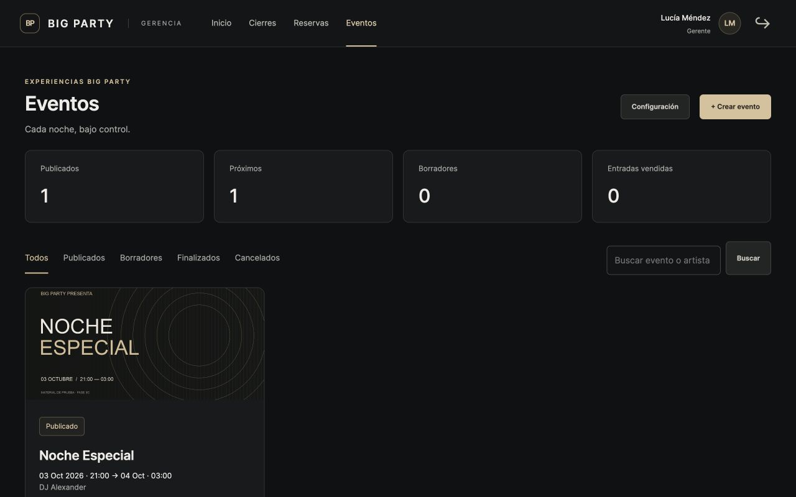 | 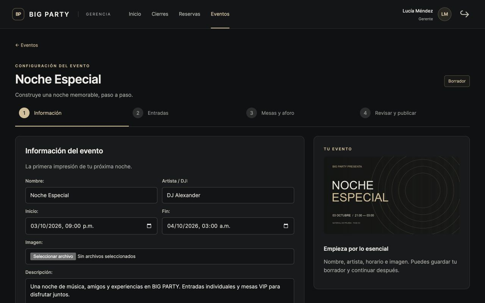 |

| C · Entradas | D · Mesas y aforo |
|---|---|
| 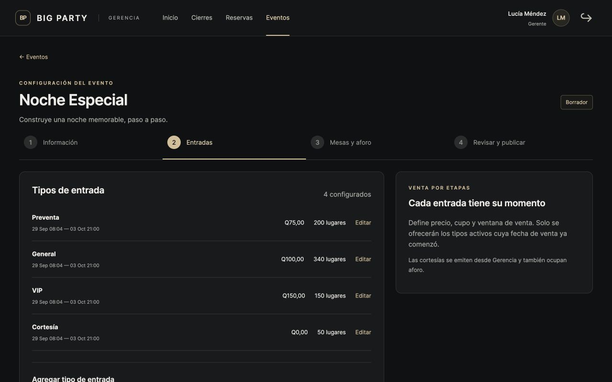 | 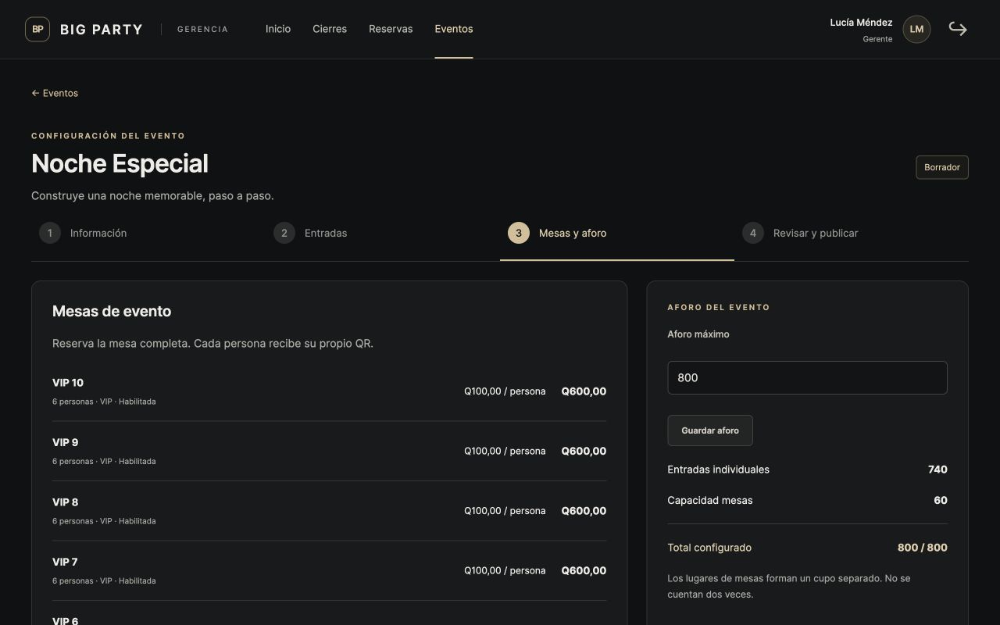 |

| E · Revisión | F · Publicado |
|---|---|
| 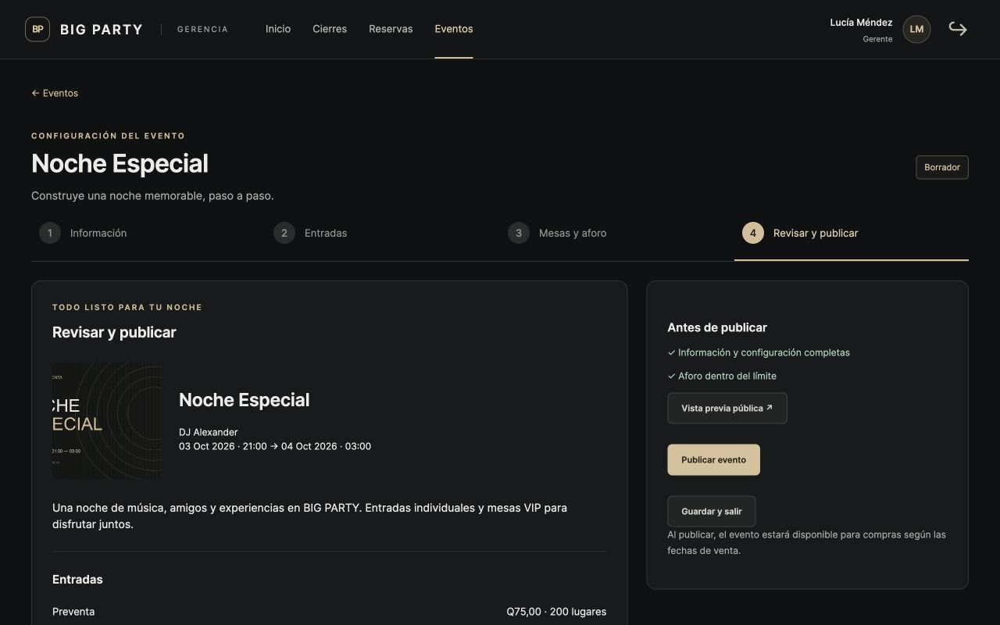 | 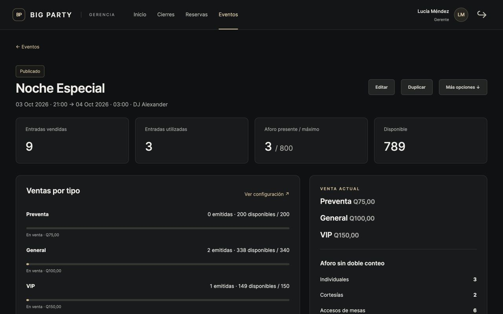 |

| G · Revisión de pago | H · Portal confirmado |
|---|---|
| 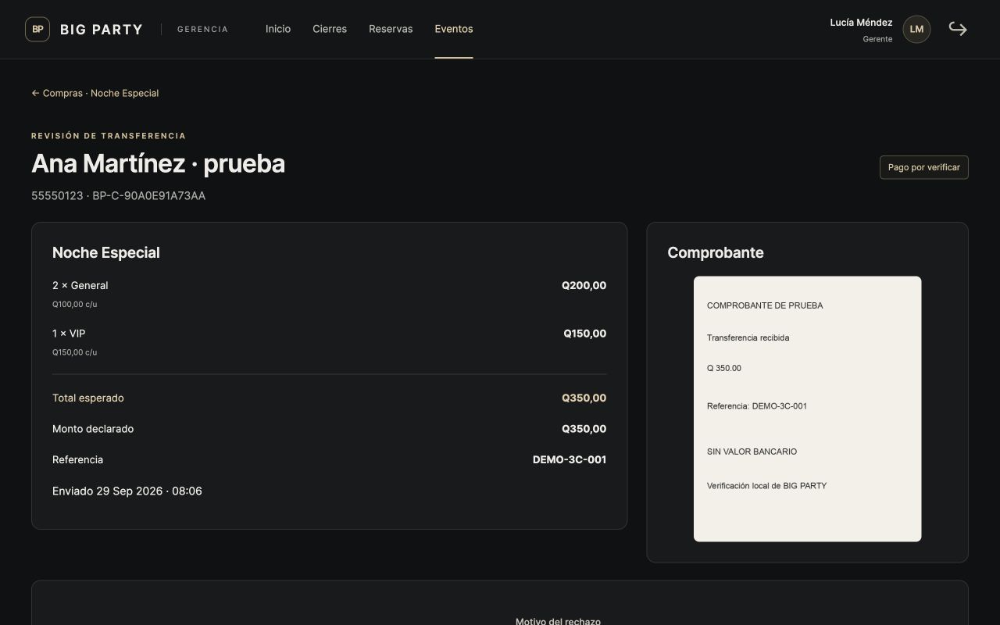 | 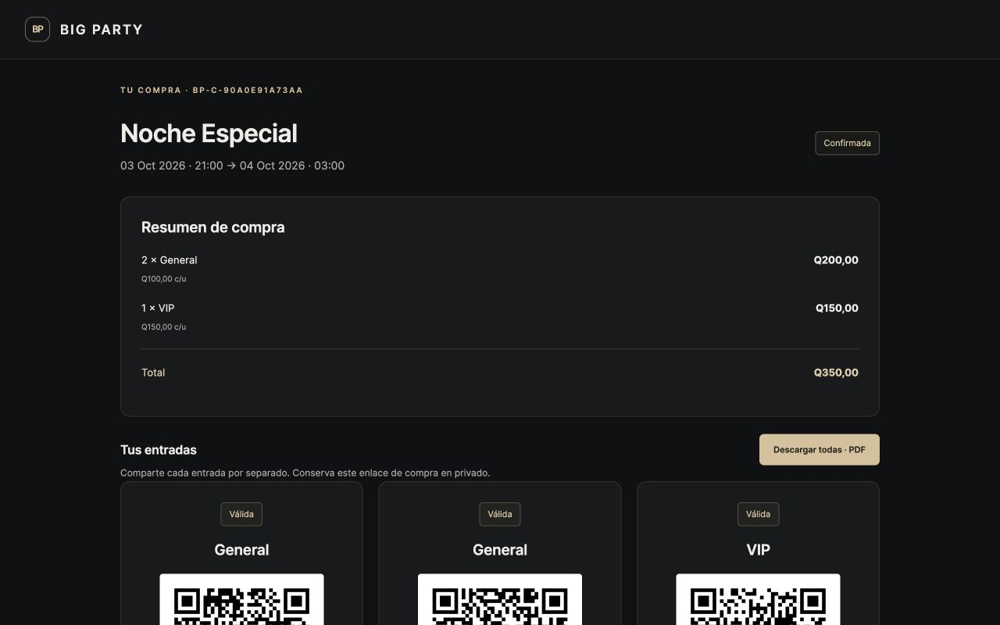 |

| I · PDF | J · Escáner antes del ingreso |
|---|---|
| 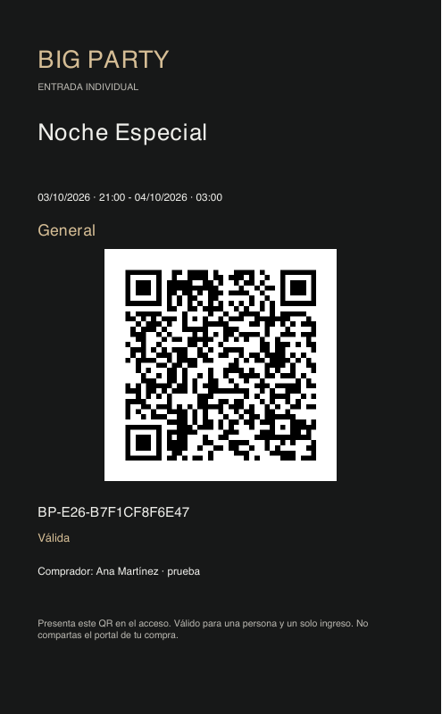 | 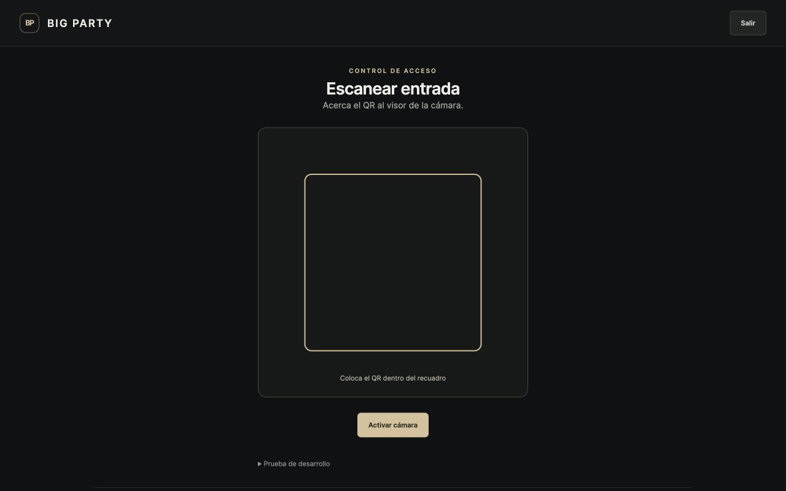 |

| K · Válida | L · Ya utilizada |
|---|---|
| 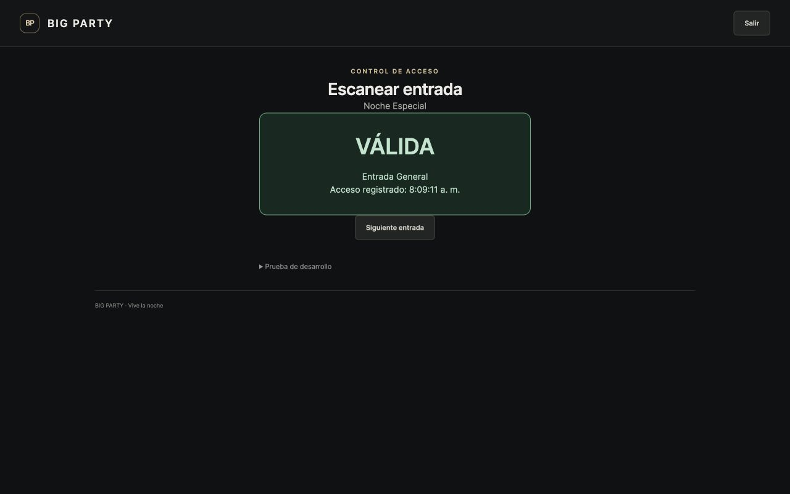 | 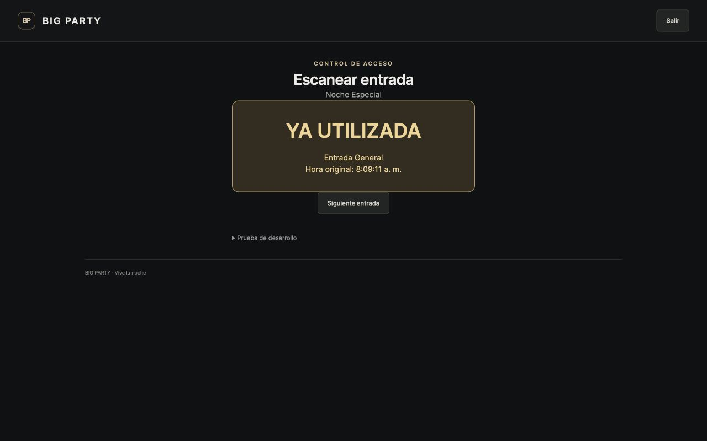 |

Captura adicional con los tres QR completos después de cancelar:
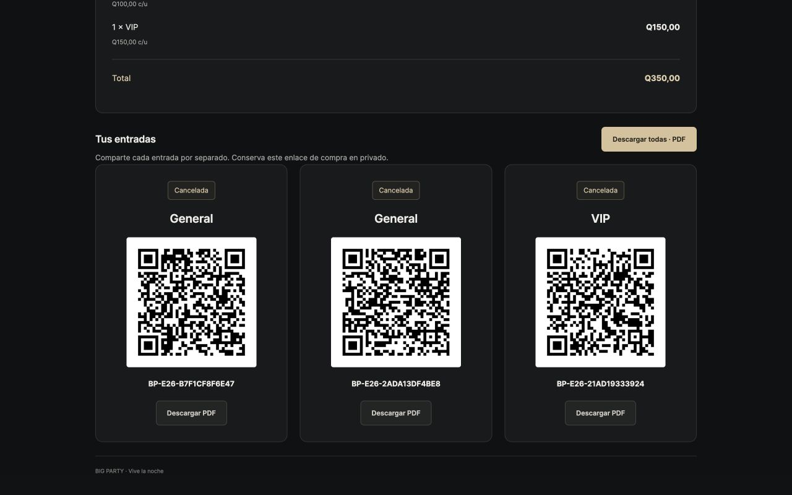

El PDF de muestra en `output/pdf/entradas-ejemplo-3c.pdf` procede del botón real de
descarga antes de cancelar. Sus tokens pertenecen exclusivamente a la base temporal.
Los archivos de evidencia se conservan; no constituyen entradas válidas del local.

## Decisiones y límites

- Una compra contiene individuales mixtas o una mesa completa; no ambos.
- Cortesías Q0 solo se emiten desde Gerencia. Venta pública requiere precio positivo.
- `RESCHEDULED` sigue siendo público/vendible; sus ventanas de venta no se desplazan solas.
- El escaneo se habilita por estado publicado/reprogramado, sin una ventana horaria adicional;
  Gerencia finaliza el evento para cerrar ingresos.
- Aforo vigente excluye tickets cancelados; indicadores históricos de ventas conservan compras.
- La disponibilidad de mesas se calcula dentro de cada evento. No se integra la agenda de
  reservas normales ni se abren cuentas de consumo en esta fase.
- Publicar requiere instrucciones operativas: configurar datos de transferencia reales,
  `PUBLIC_BASE_URL` y permisos explícitos antes del uso real. No se asignaron permisos
  ni credenciales nuevas a usuarios reales.
- PDF con ReportLab y QR con qrcode; lector JS incluido localmente, sin CDN operativo.
- Snapshot interno versionado; sin API pública de exportación ni protocolo de sincronización.
- Sin gateway, refunds, envíos automáticos, marketing premium ni avance a 3D.

## Limpieza

La base temporal, sus usuarios/sesiones, imágenes, comprobantes y archivos auxiliares
se eliminaron al cerrar la revisión. La base local conserva únicamente la migración
nueva y sus permisos, sin eventos ni compradores ficticios de esta prueba.
